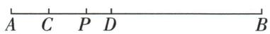
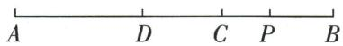

> [!success]- 必刷题
>
> > [!success] **【答案】** 6或16
>
> > [!note]- **【解析】**
> > 由题意可知 $CP = 1 \times 3 = 3(\mathrm{~cm})$ , $DB = 3 \times 4 = 12(\mathrm{~cm})$ . 当点 $D$ 在 $C$ 的右边时, 如图(1)所示:
> >
> > 
> >
> > 求出 CP, DB 的长度, 由于没有说明 D 点在 C 点的左边还是右边, 故需要分情况讨论.
> >
> > 因为 $CD = 5\mathrm{cm}$ ，所以 $CB = CD + DB = 5 + 12 =$ $17(\mathrm{cm})$ ，所以 $AC = AB - CB = 20 - 17 = 3(\mathrm{cm})$ ，所以 $AP = AC + CP = 3 + 3 = 6(\mathrm{cm})$ ；当点 $D$ 在 $C$ 的左边时，如图(2)所示：
> >
> > 
> >
> > 所以 $AD = AB - DB = 20 - 12 = 8(\mathrm{cm})$ ，所以 $AP = AD + CD + CP = 8 + 5 + 3 = 16(\mathrm{cm})$ .综上所述， $AP = 6\mathrm{cm}$ 或 $16~\mathrm{cm}$ 故答案为6或16.
