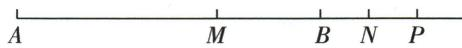

> [!success]- 必刷题
>
> > [!success] **【答案】** 详见解析
>
> > [!note]- **【解析】**
> > 【解】(1)当x=5时, $AP=2\times5=10$ .因为M为AP的中点,所以 $AM=\frac{1}{2}AP=5$ ,所以BM=AB-AM=19,所以BM的长为19.
> > (2) 当 P 在线段 AB 上运动时，2BM-PB 是定值。由题意知， $AM=\frac{1}{2}AP$ ，BM=AB-AM，所以 $2BM-PB=2(AB-AM)-(AB-AP)=2AB-AP-AB+AP=AB=24$ ，所以 2BM-PB 是定值，定值为 24.
> >
> > (3) 当 P 在线段 AB 上运动时, 如图(1).
> > 图(1)
> >
> > 由题意知, $PN=\frac{1}{2}BP$ , $MP=\frac{1}{2}AP$ ,所以MN= $MP+NP=\frac{1}{2}(AP+BP)=\frac{1}{2}AB=12.$ 当P在线段AB的延长线上运动时,如图(2).
> >
> > 
> >
> > 由题意知, $PN=\frac{1}{2}BP$ , $MP=\frac{1}{2}AP$ ,所以MN=MP-NP= $\frac{1}{2}(AP-BP)=\frac{1}{2}AB=12$ .综上所述,MN的长为12.
> >
> > ## 2 角
> >
> > ## 课时1 角
> >
> > ## 刷基础
