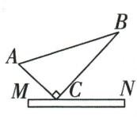
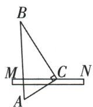
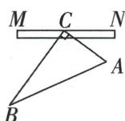

<!-- question-source:start -->
1[2025 河北石家庄期中, 中]把直角三角板的直角顶点 C 放在直尺的一边 MN 上.

(1) 点 A 和点 B 在直线 MN 的上方(如图(1))，此时 $\angle ACM$ 与 $\angle BCN$ 的数量关系是 $\angle ACM + \angle BCN =$ \_\_\_\_ ;

(2)当把这把直角三角板绕顶点 C 旋转到点 A 在直线 MN 的下方、点 B 仍然在直线 MN 的上方时(如图(2)), $\angle ACM$ 与 $\angle BCN$ 的数量关系是\_\_\_\_;

(3)当把这把直角三角板绕顶点 C 旋转到点 A 和点 B 都在直线 MN 的下方时（如图(3)）， $\angle ACM$ 与 $\angle BCN$ 的数量关系是 \_\_\_\_.

图(1)

图(2)

图(3)
<!-- question-source:end -->

![[Q00103013A1]]
