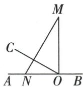
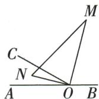
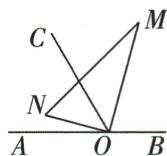

<!-- question-source:start -->
2[2025 广东潮州期末, 中]如图(1), O 为直线 AB 上一点, 过点 O 作射线 OC, $\angle AOC = 30^{\circ}$ , 将一直角三角板 ( $\angle M = 30^{\circ}$ ) 的直角顶点放在点 O 处, 一边 ON 在射线 OA 上, 另一边 OM 与射线 OC 都在直线 AB 的上方. (注: 本题中最大旋转角度为 $180^{\circ}$ )

(1) 将图(1)中的三角板绕点 O 以每秒 $3^{\circ}$ 的速度沿顺时针方向旋转. 如图(2), 经过 t 秒后, $\angle AON =$ \_\_\_\_  度 (用含 t 的式子表示), 若 OM 恰好平分 $\angle BOC$ , 则 t = \_\_\_\_.

(2)在(1)的基础上,若三角板在转动的同时,射线 OC 也绕 O 点以每秒 $6^{\circ}$ 的速度沿顺时针方向旋转,如图(3),经过 t 秒后, $\angle AOC=$ \_\_\_\_度(用含 t 的式子表示),若 OC 平分

∠MON, 求 t 的值.

  
图(1)

  
图(2)

  
图(3)
<!-- question-source:end -->

![[Q00096502A1]]
