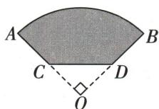

<!-- question-source:start -->
10[2024 山西中考]如图(1)是小区围墙上的花窗,其形状是扇形的一部分,图(2)是其几何示意图(阴影部分为花窗).通过测量得到扇形AOB的圆心角为 $90^{\circ}$ ,OA=1m,点C,D分别为OA,OB的中点,则花窗的面积为\_\_\_\_m².

  
图(1)

  
图(2)
<!-- question-source:end -->
