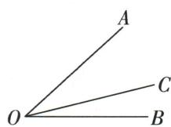
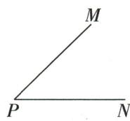

<!-- question-source:start -->
12 如图, 已知 OC 是 $\angle AOB$ 内部的一条射线, 图中有三个角: $\angle AOB$ , $\angle AOC$ 和 $\angle BOC$ , 当其中一个角是另一个角的两倍时, 称射线 OC 为 $\angle AOB$ 的“巧分线”. 如果 $\angle MPN = 45^{\circ}$ , PQ 是 $\angle MPN$ 的“巧分线”, 则 $\angle MPQ =$ \_\_\_\_ $^{\circ}$ .

<!-- question-source:end -->
