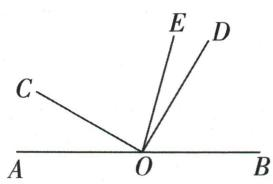
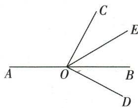

<!-- question-source:start -->
16 已知 O 是直线 AB 上的一点, $\angle COD$ 是直角, OE 平分 $\angle BOC$ .
(1) 如图(1), 若 $\angle AOC = 30^{\circ}$ , 求 $\angle COE$ , $\angle DOB$ 的度数.
(2)如图(1)，若 $\angle AOC=\alpha$ ，求 $\angle DOE$ 的度数（用含 $\alpha$ 的代数式表示）.
(3)将图(1)中的 $\angle COD$ 绕顶点O顺时针旋转至图(2)的位置,探究 $\angle AOC$ 与 $\angle DOE$ 的数量关系,并说明理由.

  
图(1)

  
图(2)

电子错题本鸭
<!-- question-source:end -->
