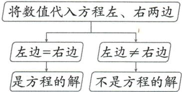

> [!success]- 必刷题
>
> > [!success] **【答案】** B
>
> > [!note]- **【解析】**
> > 
> > 【解析】将 x = -2 代入 $2x + 5 = 1 - x$ 的左、右两边，左边 $= -2 \times 2 + 5 = 1$ ，右边 $= 1 - (-2) = 3$ ，左边 ≠ 右边，故 A 选项不符合题意；将 x = -2 代入 $3 - 2(x - 1) = 7 - x$ 的左、右两边，左边 $= 3 - 2 \times (-2 - 1) = 9$ ，右边 $= 7 - (-2) = 9$ ，左边 = 右边，故 B 选项符合题意；将 x = -2 代入 x - 5 = 5 - x 的左、右两边，左边 = -2 - 5 = -7，右边 = 5 - (-2) = 7，左边 ≠ 右边，故 C 选项不符合题意；将 x = -2 代入 $1 - \frac{1}{4}x = \frac{3}{4}x$ 的左、右两边，左边 $= 1 - \frac{1}{4} \times (-2) = \frac{3}{2}$ ，右边 $= \frac{3}{4} \times (-2) = -\frac{3}{2}$ ，左边 ≠ 右边，故 D 选项不符合题意。
> >
> > 故选 **B**.
