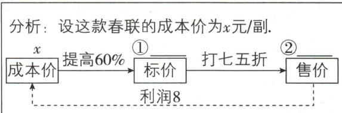

<!-- question-source:start -->
1 新考法[2025 山西太原期末]数学课上, 王老师提出如下问题: 某店家销售一款网红春联, 将这款春联的成本价提高 60% 后标价, 又以七五折优惠卖出, 结果每副春联仍获利 8 元, 求这款春联每副的标价. 小敏用下面的框图直观地表示了店家从进货、标价到销售获利的过程:

请你用含 $x$ 的代数式补全框图中空缺的部分，并利用一元一次方程的知识求这款春联每副的标价.
<!-- question-source:end -->
