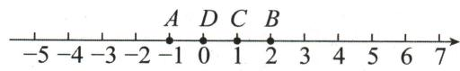

<!-- question-source:start -->
13 在数轴上,对于不重合的三点 $A, B, C$ ,给出如下定义:若点 $C$ 到点 $A$ 的距离是点 $C$ 到点 $B$ 的距离的 2 倍,我们就把点 $C$ 叫作【 $A, B$ 】的和谐点.例如:如图,点 $A$ 表示的数为 -1 ,点 $B$ 表示的数为 2 .表示数 1 的点 $C$ 到点 $A$ 的距离是 2 ,到点 $B$ 的距离是 1 .那么点 $C$ 是【 $A, B$ 】的和谐点;又比如,表示数 0 的点 $D$ 到点 $A$ 的距离是 1 ,到点 $B$ 的距离是 2 ,那么点 $D$ 就不是【 $A, B$ 】的和谐点,但点 $D$ 是【 $B, A$ 】的和谐点.(1)当点 $A$ 表示的数为 -4 ,点 $B$ 表示的数为 8 时,

①若点 C 表示的数为 4, 则点 C \_\_\_\_ (填 “是”或“不是”)【A, B】的和谐点;

②若点 D 是 $[B, A]$ 的和谐点, 则点 D 表示的数是 \_\_\_\_;

(2) 若 A, B 在数轴上表示的数分别为 -2 和 4, 现有一点 C 从点 B 出发, 以每秒 1 个单位长度的速度向数轴负半轴方向运动, 当点 C 到达点 A 时停止, 问当点 C 运动多少秒时, C, A, B 中恰有一个点为其余两点的和谐点?

<!-- question-source:end -->

![[Q00103194A1]]
