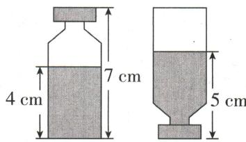

<!-- question-source:start -->
5[2024 四川成都期末, 中]已知关于 $x$ 的方程 $(a - 2)x^{|a| - 1} + 4b = 0$ 为一元一次方程, 且该方程的解与关于 $x$ 的方程 $\frac{2x + 1}{3} = \frac{x - b}{2} + 1$ 的解相同.

(1) 求 $a, b$ 的值;

(2) 若关于 $y$ 的方程 $|m - 1|y + n = a + 1 + 2by$ 有无数个解, 求 $m, n$ 的值.

<!-- question-source:end -->
