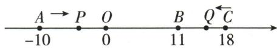

<!-- question-source:start -->
3[2024 江苏苏州期末,较难]如图,在数轴上,点A对应的数为-10,点B对应的数为11,点C对应的数为18.动点P从点A出发,沿数轴正方向以每秒2个单位长度的速度匀速运动.同时,动点Q从点C出发,沿数轴负方向以每秒1个单位长度的速度匀速运动.设运动时间为t秒.
(1) 当 t 为何值时, P, Q 两点相遇? 相遇点 M 所对应的数是多少?

(2)在点 Q 出发后到达点 B 之前, 求 t 为何值时, 点 P 到点 O 的距离与点 Q 到点 B 的距离相等.

(3) 在点 P 向右运动的过程中, N 为数轴上一动点, 且 NA = NP, 在点 P 到达点 C 之前, 求 2CN - PC 的值.

<!-- question-source:end -->
