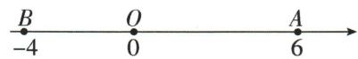

<!-- question-source:start -->
4[2024 安徽安庆质检,较难]如图,已知数轴上三点A,O,B表示的数分别为6,0,-4,动点P从A出发,以每秒6个单位长度的速度沿数轴向左匀速运动.另一动点R从B出发,以每秒4个单位长度的速度沿数轴向左匀速运动,若点P,R同时出发,则点P运动\_\_\_\_秒时,追上点R.

是个新“烤”鸭

电子错题本鸭

建议用时 20 分钟 答案 D56
<!-- question-source:end -->

![[Q00103174A1]]
