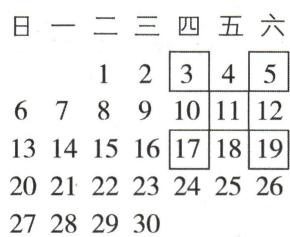

<!-- question-source:start -->
17[2024 安徽六安金安区期末, 中]如图, 在某月的日历表中用框数器“☐”框出 3,5,11,17, 19 五个数, 它们的和为 55, 若将“☐”在图中换个位置框出五个数, 则它们的和可能是 ( )

A. 40 B. 88 C. 107 D. 110
<!-- question-source:end -->

![[Q00103169A1]]
