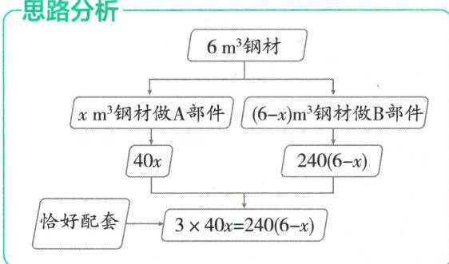

> [!success]- 必刷题
>
> > [!success] **【答案】** D
>
> > [!note]- **【解析】**
> > 【解】(1)正常情况下,甲、乙两队能履行该合同.理由如下:设甲、乙两队合作需x天完成这项工程.根据题意得 $\frac{x}{30}+\frac{x}{20}=1$ ,解得x=12.
> > 因为12<15,所以正常情况下,甲、乙两队能履行该合同.
> > (2)调走甲队更合适.理由如下:设调走乙队,
> > 甲队还需m天完成这项工程.根据题意得 $\frac{m}{30}+75\%=1$ ,解得 $m=\frac{15}{2}$ ,所以 $12\times75\%+\frac{15}{2}=$
> >
> > 刷有所得
> > 此类配套问题
> > 需要找到两个
> > 等量关系, 其
> > 中一个等量关
> > 系用来表示未
> > 知量, 另一个
> > 等量关系用来
> > 列方程.
> >
> > 思路分析
> > 设男生应向女生支援 y 人, 根据男生制作筒底的数量 = 女生制作筒身的数量 × 2, 列出方程, 求解即可.
> >
> > ## 思路分析
> >
> > 设先安排整理的人员有 x 人, 则一共有 $(x+5)$ 人. 根据题意可得等量关系: 开始 x 人 2 h 的工作量 + 后来 $(x+5)$ 人 3 h 的工作量 = 1, 把相关数值代入即可求解.
> >
> > $\frac{33}{2}$ (天). 因为 $\frac{33}{2}>15$ , 所以调走乙队不合适. 设调走甲队, 乙队还需 n 天完成这项工程. 根据题意得 $\frac{n}{20}+75\%=1$ , 解得 n=5, 所以 $12\times75\%+5=14$ (天). 因为 14<15, 所以调走甲队更合适.
> >
> > ## 7. D
> >
> > 
> >
> > 【解析】设用 $x \, m^{3}$ 钢材制作 A 部件，则用 $(6 - x) \, \mathrm{m}^{3}$ 钢材制作 B 部件。依题意得 $3 \times 40x = 240(6 - x)$ ，解得 x = 4，则 6 - x = 2，40x = 160。即用 $4 \, m^{3}$ 钢材做 A 部件，用 $2 \, m^{3}$ 钢材做 B 部件，恰好配成 160 套仪器。故选 D。
> >
> > 18.4 【解析】设七年级(2)班男生有x人,则女生有 $(x+2)$ 人.由题意得 $x+x+2=50$ ,解得x=24, $24+2=26$ (人),所以七年级(2)班男生有24人,女生有26人.设男生应向女生支援y人.由题意得 $120\times(24-y)=(26+y)\times40\times2$ ,解得y=4,所以男生应向女生支援4人,才能使每时剪出的筒身与筒底刚好配套.故答案为4.
