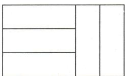
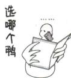

<!-- question-source:start -->
3 五个完全相同的小长方形拼成如图所示的大长方形,大长方形的周长是 $32 \, cm$ , 则小长方形的面积是 ( )

A. $8 \mathrm{~cm}^{2}$ B. $10 \mathrm{~cm}^{2}$ C. $12 \mathrm{~cm}^{2}$ D. $16 \mathrm{~cm}^{2}$
<!-- question-source:end -->

![[Q00096614A1]]
