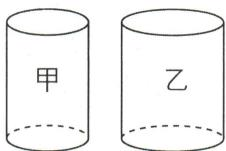

<!-- question-source:start -->
4[2024 天津和平区期末]如图,在水平桌面上有甲、乙两个圆柱形容器,其内部底面积分别为 $80\ cm^{2},100\ cm^{2}$ ,且甲容器装满水,乙容器是空的.若将甲中的水全部倒入乙中,则乙中的水位高度比原先甲中的水位高度低了8 cm,则甲的容积是()

A. $1280\mathrm{cm}^3$ B. $2560\mathrm{cm}^3$ C. $3200\mathrm{cm}^3$ D. $4000\mathrm{cm}^3$

  
(第4题图)  
(第5题图)
<!-- question-source:end -->

![[Q00096615A1]]
