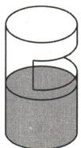
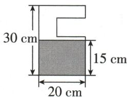
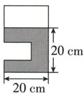

<!-- question-source:start -->
2[中]有一个不完整圆柱体玻璃密封容器如图(1),测得其底面直径a为20cm,高为30cm,其内装液体若干,若如图(2)放置时,测得液面高度为15cm;如图(3)放置时,测得液面高度为20cm,则该玻璃密封容器的总容积是\_\_\_\_。(结果保留π)

  
图(1)

  
图(2)

  
图(3)
<!-- question-source:end -->
