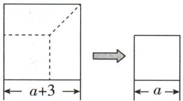
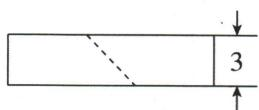

<!-- question-source:start -->
3[中]如图(1)，将边长为 $a+3$ 的正方形纸片剪去一个边长为a的正方形后，剩余部分可剪拼成如图(2)所示的长方形（不重叠无缝隙），若拼成的长方形的宽为3，请解答下列问题：

(1)用含 a 的代数式表示剪拼后所得长方形的周长为\_\_\_\_；用含 a 的代数式表示剪拼后所得长方形的面积为\_\_\_\_。

(2)若剪拼后所得长方形的周长为 20, 则 a 的值是 \_\_\_\_.

(3)若将剪拼后的长方形的长减少2,宽增加1,所得的新长方形的面积恰好等于原长方形的面积,则a的值是\_\_\_\_.

  
图(1)

  
图(2)
<!-- question-source:end -->
