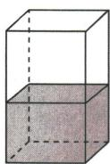
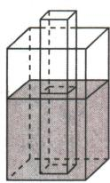
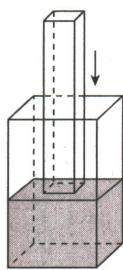

<!-- question-source:start -->
5 核心素养 模型观念 [2025 浙江湖州期末,较难] 如图(1)所示,爱心农场的一个长、宽、高分别为 12 分米、8 分米、20 分米的长方体鱼池内装有高度为 9 分米的水. 某项目化学习小组需要将一长方体基座(足够高)放置在鱼池内. 若基座竖直放置在鱼池底部,如图(2)所示,则池内水面上升 3 分米.

图(1)
图(2)

图(3)

(1) 求基座的底面积;

(2)在安装过程中,先将基座吊起,使得基座的底部与水面齐平,如图(3)所示,然后将基座以2分米/分的速度下降,设下降的时间为t分,求当t=2时,水面上升的高度;

(3)在(2)的条件下,求下降过程中,基座的底面把池中水深分成1:2的两部分时t的值.
<!-- question-source:end -->

![[Q00103131A1]]
