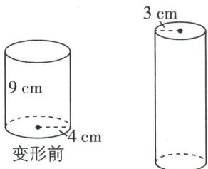

> [!success]- 必刷题
>
> > [!success] **【答案】** 详见解析
>
> > [!note]- **【解析】**
> > 【解】(1)如图.
> >
> >   
> > 变形后
> >
> > (2) 设变形后模型的高为 $x \mathrm{~cm}$ . 根据题意得 $\pi \times 4^{2} \times 9 = \pi \times 3^{2} \times x$ , 解得 $x = 16$ . 答: 变形后模型的高为 $16 \mathrm{~cm}$ .
> >
> > ## 刷易错·
