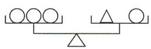
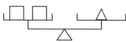

<!-- question-source:start -->
3[2024 广西桂林质检]设“○”“△”“□”表示三种不同的物体,现用天平称了两次,天平都处于平衡状态(如图),则下列式子中“□”和“○”的关系正确的是()

图(1)

图(2)

A. $\square = \bigcirc$ B. $\square = 2\bigcirc$ C. $2\square = 3\bigcirc$ D. $3\square = 4\bigcirc$
<!-- question-source:end -->

![[Q00103058A1]]
