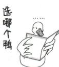

<!-- question-source:start -->
5[2025 浙江宁波期末]下列方程的变形正确的是
( )
A. 2x=1, 变形为 x=2
B. $x+5=3-3x$ , 变形为 4x=2
C. $\frac{2}{3}x-1=2$ , 变形为 2x-3=2
D. 3x-6=0, 变形为 3x=6

<!-- question-source:end -->

![[Q00103060A1]]
