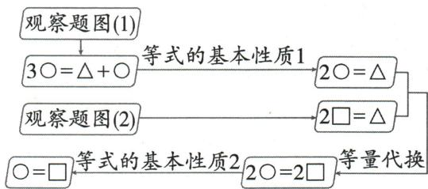

> [!success]- 必刷题
>
> > [!success] **【答案】** B
>
> > [!note]- **【解析】**
> > 若 a=5，则 $a^{2}=5a$ ，A 正确，不符合题意；bm=bn，则 m=n，前提是 $b\neq0$ ，B 错误，符合题意；若 $\frac{m}{b}=\frac{n}{b}$ ，则 m=n，C 正确，不符合题意；若 $-\frac{x}{2}=8$ ，则 x=-16，D 正确，不符合题意。故选 B.
> >
> > ## 3. A 【解析】
> >
> > 
