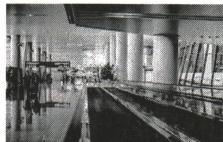

<!-- question-source:start -->
4[中]如图(1)所示是某机场的平地电梯,其示意图如图(2)所示,电梯AB的长度为120米,若两人不乘电梯在地面匀速行走,小明每分行走的路程是小红的 $\frac{7}{5}$ 倍,且1.5分后,小明比小红多行走30米.
(1)求两人在地面上每分各行走多少米;
(2)若两人在平地电梯上从A处开始行走,电梯以30米/分的速度向前匀速行驶,两人保持原来在地面上匀速行走的速度同时在电梯上行走. 当小明到达 B 处时, 小红离 B 处还有多少米?

  
图(1)

<table><tr><td>A</td><td colspan="4">地面</td><td>B</td></tr><tr><td></td><td></td><td></td><td></td><td>平地电梯</td><td></td></tr></table>

图(2)
<!-- question-source:end -->

![[Q00096638A1]]
