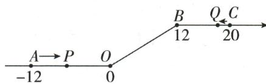

<!-- question-source:start -->
5[2025甘肃兰州期末,较难]如图,将一条数轴在原点O和点B处各折一下,得到一条“折线数轴”,图中点A表示-12,点B表示12,点C表示20,我们称点A和点C在数轴上相距32个单位长度,动点P从点A出发,以2单位长度/秒的速度沿着“折线数轴”的正方向运动,从点O运动到点B期间速度变为原来的一半,之后立刻恢复原速;同时,动点Q从点C出发,以1单位长度/秒的速度沿着数轴的负方向运动,从点B运动到点O期间速度变为原来的两倍,之后也立刻恢复原速,设运动的时间为t秒.
(1) 动点 Q 从点 C 运动到点 A 需要 \_\_\_\_ 秒;
(2) 求 P, Q 两点相遇时的 t 值及相遇点 M 所对应的数是多少;
(3) 求当 t 为何值时, A, P 两点在数轴上相距的长度是 C, Q 两点在数轴上相距的长度的 $\frac{5}{4}$ 倍 (即 P 点运动的路程 $=\frac{5}{4}Q$ 点运动的路程).

<!-- question-source:end -->
