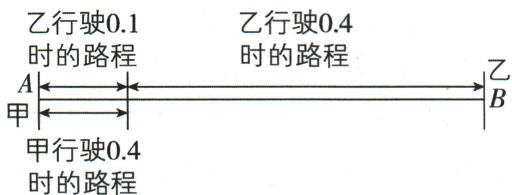

<!-- question-source:start -->
2 新考法[2025 浙江衢州期末]【阅读理解】甲、乙两人分别从 A, B 两地同时出发, 甲骑自行车, 乙骑摩托车, 两人沿同一条路线相向匀速行驶, 出发后经过 0.4 时相遇, 已知在相遇时乙比甲多行驶了 14.4 千米, 相遇后经过 0.1 时乙到达 A 地. 问甲、乙两人的速度分别是多少? 可以用如图所示的示意图来分析本题中的等量关系.

根据题意,从图中可得如下的等量关系:

甲行驶 0.4 时的路程 = 乙行驶 0.1 时的路程，

甲行驶 0.4 时的路程 + 14.4 千米 = 乙行驶 0.4 时的路程.

根据这两个等量关系,可得到甲、乙两人速度的关系,再设元列出方程,即可解决问题.

【问题解决】请你列方程解答【阅读理解】中的问题.

【能力提升】对于上题,若乙出发0.2时后,其行驶速度减少10千米/时,问甲出发后经过多长时间两人相距2千米?

建议用时 20 分钟 答案 D52
<!-- question-source:end -->
