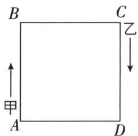

<!-- question-source:start -->
2[较难]如图,正方形ABCD的轨道上有甲、乙两个点,开始时甲在A处,乙在C处,它们沿着正方形轨道顺时针运动且同时出发,甲的速度为每秒1cm,乙的速度为每秒5cm.已知正方形轨道ABCD的边长为2cm,则乙在第2022次追上甲时的位置在()

A. $AB$ 上 B. $BC$ 上 C. $CD$ 上 D. $AD$ 上
<!-- question-source:end -->

![[Q00103145A1]]
