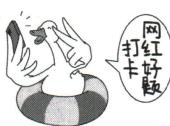

<!-- question-source:start -->
3[2024 江苏常州钟楼区质检]若代数式 $6+\frac{x}{3}$ 与 $\frac{8-2x}{2}$ 的值相等, 则 x 的值是 ( )
A. $\frac{1}{2}$ B. $-\frac{1}{2}$ C. $\frac{3}{2}$ D. $-\frac{3}{2}$

<!-- question-source:end -->
