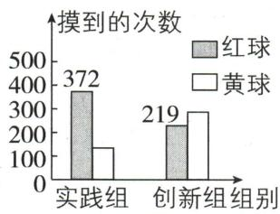
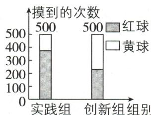

<!-- question-source:start -->
5[2024 江苏镇江中考节选]有甲、乙两只不透明的袋子,每只袋子中装有红球和黄球若干,各袋中所装球的总个数相同,这些球除颜色外都相同.实践组用甲袋、创新组用乙袋各自做摸球试验:两人一组,一人从袋中任意摸出1个球,另一人记下颜色后将球放回并搅匀,各组连续做这样的试验,将记录的数据绘制成如下两种条形统计图:

  
A图

  
B图

(1)\_\_\_\_图能更好地反映各组试验的总次数,\_\_\_\_图能更好地反映各组试验摸到红球的频数(填“A”或“B”);

(2)根据以上两种条形统计图,你还能获得哪些信息(写出一条即可)?
<!-- question-source:end -->

![[Q00096743A1]]
