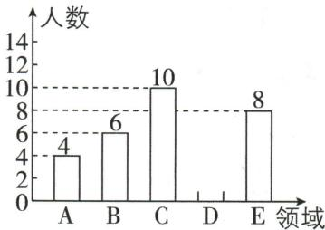
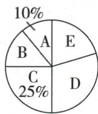
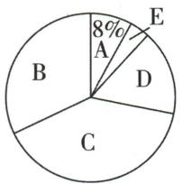
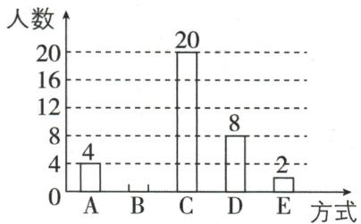

<!-- question-source:start -->
9[2025 河南郑州期末]为提高学生的网络认知,某校准备开展“工业互联网”研学活动,并请专家为学生做五个领域的主题报告:A. 数字孪生;B. 人工智能;C. 应用 5G;D. 工业机器人;E. 区块链.

【收集数据】为了解学生的研学意向,在随机抽取的部分学生中下发调查问卷.

“工业互联网”主题日学生研学意向调查问卷
请选择您的研学意向,并在其后“□”内打“√”
(每名同学必选且只能选择其中一项).
A. 数字孪生□ B. 人工智能□
C. 应用5G□ D. 工业机器人□
E. 区块链□

【整理数据】所有问卷全部收回且有效,根据调查数据绘制成如下两幅不完整的统计图.

【分析数据】请根据统计图提供的信息,解答下列问题:

(1) 求本次调查所抽取的学生人数, 并补全条形统计图.

(2) 求扇形统计图中“E”对应扇形的圆心角的度数.

(3) 学校有 600 名学生参加本次活动, 其中选择聆听 B、D 领域报告的学生各有多少?

(4) 在(3)的条件下, 在确保听取报告的每名学生都有座位的情况下, 请你合理安排 B、D 领域的两场报告, 补全此次活动日程表.

<table><tr><td colspan="3">“工业互联网”主题日活动日程表</td></tr><tr><td>地点(座位数)时间</td><td>1号多功能厅(200座)</td><td>2号多功能厅(100座)</td></tr><tr><td>8:00—9:30</td><td>E</td><td>A</td></tr><tr><td>10:00—11:30</td><td>C</td><td>1_</td></tr><tr><td>13:00—14:30</td><td>2_</td><td>设备检修暂停使用</td></tr></table>

电子错题本鸭

建议用时 25 分钟 答案 D63

[2024 山西晋中质检, 中]近年来, 人口老龄化现象日益严峻, 引起全社会的广泛关注. 某校为引导学生关注社会生活, 关爱老年人, 就当地老年人生活状况展开调查研究.

【收集数据,描述数据】学校对当地某社区部分老年人的生活状况之处理生病问题的方式进行了调查,经过对问卷的整理,得到结果并形成如下调查报告:

<table><tr><td>课题主题</td><td>当地老年人生活状况调查——处理生病问题的方式</td></tr><tr><td>活动目标</td><td>关注社会生活,关爱老年人,增强社会责任意识和关爱他人的意识,促进全面发展</td></tr><tr><td>调查方式</td><td>抽样调查</td></tr><tr><td rowspan="2">数据的收集、整理与描述</td><td>处理生病问题的方式的调查问卷您好!这是一份关于处理生病问题的方式的调查问卷,请选择一项您最常使用的方式,在其后的括号内打“√”,非常感谢您的配合!A.子女陪同去医院就诊( );B.独自去医院就诊( );C.自己在家里服用备用药( );D.请人帮忙购药( );E.雇佣他人陪同去医院就诊( )</td></tr><tr><td>所有问卷全部收回,并将调查结果绘制成如下两幅不完整的统计图:</td></tr><tr><td>调查结论</td><td>......</td></tr></table>

【评估反思】(1)在扇形统计图中,“D”所占的百分比为\_\_\_\_,“C”所在扇形的圆心角度数为\_\_\_\_度,请补全条形统计图.

(2)根据调查结果,估计该社区500名老年人中感觉身体不适时,选择独自去医院就诊的人数.

(3)请你结合上述调查报告写出两条通过分析获取的信息.
<!-- question-source:end -->

![[Q00096751A1]]
