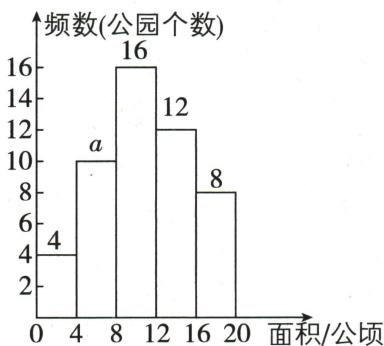

<!-- question-source:start -->
3[2024 广东广州中考改编]为了解公园用地面积 $x$ (单位: 公顷) 的基本情况, 某地随机调查了本地 50 个公园的用地面积, 按照 $0 < x \leqslant 4, 4 < x \leqslant 8, 8 < x \leqslant 12, 12 < x \leqslant 16, 16 < x \leqslant 20$ 的分组绘制了如图所示的频数直方图, 下列说法正确的是 ( )

A. $a$ 的值为 20  
B. 用地面积在 $8 < x \leqslant 12$ 这一组的公园个数最多  
C. 用地面积在 $4 < x \leqslant 8$ 这一组的公园个数最少  
D. 这 50 个公园中有一半以上的公园用地面积超过 12 公顷
<!-- question-source:end -->
