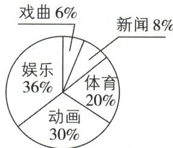

<!-- question-source:start -->
4[2024 山东济宁中考]为了解全班同学对新闻、体育、动画、娱乐、戏曲五类节目的喜爱情况,班主任对全班50名

同学进行了问卷调查(每名同学只选其中的一类),依据50份问卷调查结果绘制了全班同学喜爱节目情况扇形统计图(如图所示).下列说法正确的是
A. 班主任采用的是抽样调查
B. 喜爱动画节目的同学最多
C. 喜爱戏曲节目的同学有6名
D. “体育”对应扇形的圆心角为72°
<!-- question-source:end -->
