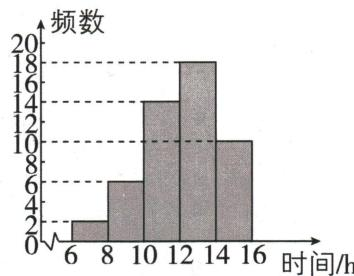

<!-- question-source:start -->
5[2024 山东青岛市南区期末]某校为了解七年级700名学生上学期参加社会实践活动的时间,随机对该年级部分学生进行了调查.根据收集的数据绘制了下面的频数直方图(每组含前一个边界值,不含后一个边界值),则以下说法正确的是()

A. 一共调查了 40 名学生  
B. 图中五个小长方形的面积比是 $1:9:49:81:25$ C. 估计七年级 700

名学生参加社会实践活动时间少于 $10\mathrm{h}$ 的有112名学生D.随机抽取的学生中参加社会实践活动时间不少于 $10\mathrm{h}$ 的有32名学生
<!-- question-source:end -->
