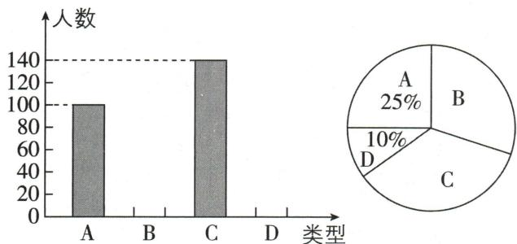
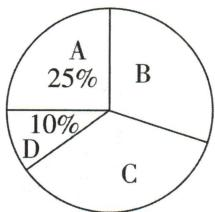

<!-- question-source:start -->
7 高尔基说:“书籍是人类进步的阶梯.”阅读可以丰富知识,拓宽视野,充实生活,让我们感受到愉快.某中学计划在各班设立图书角,为合理搭配各类书籍,学校团委以“我最喜爱的书籍”为主题,对全校学生进行抽样调查,收集整理喜爱的书籍类型(A.科普,B.文学,C.体育,D.其他)数据后,绘制出两幅不完整的统计图如图所示.小亮根据这两幅不完整的统计图得出以下4个结论:①最喜爱B类型书籍的人数为120;②C类型所占百分比为30%;③C类型所对应的扇形的圆心角为 $126^{\circ}$ ; ④最喜爱 D 类型书籍的人数是最喜爱 B 类型书籍的人数的 $\frac{1}{3}$ ，则结论错误的是 \_\_\_\_。（请填写序号）

<!-- question-source:end -->

![[Q00103245A1]]
