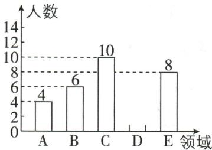
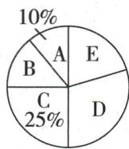

<!-- question-source:start -->
9[2025 河南郑州期末]为提高学生的网络认知,某校准备开展“工业互联网”研学活动,并请专家为学生做五个领域的主题报告:A. 数字孪生;B. 人工智能;C. 应用 5G;D. 工业机器人;E. 区块链.

【收集数据】为了解学生的研学意向,在随机抽取的部分学生中下发调查问卷.

“工业互联网”主题日学生研学意向调查问卷
请选择您的研学意向,并在其后“□”内打“√”
(每名同学必选且只能选择其中一项).
A. 数字孪生□ B. 人工智能□
C. 应用5G□ D. 工业机器人□
E. 区块链□

【整理数据】所有问卷全部收回且有效,根据调查数据绘制成如下两幅不完整的统计图.

【分析数据】请根据统计图提供的信息,解答下列问题:

(1) 求本次调查所抽取的学生人数, 并补全条形统计图.

(2) 求扇形统计图中“E”对应扇形的圆心角的度数.

(3) 学校有 600 名学生参加本次活动, 其中选择聆听 B、D 领域报告的学生各有多少?

(4) 在(3)的条件下, 在确保听取报告的每名学生都有座位的情况下, 请你合理安排 B、D 领域的两场报告, 补全此次活动日程表.

<table><tr><td colspan="3">“工业互联网”主题日活动日程表</td></tr><tr><td>地点(座位数)时间</td><td>1号多功能厅(200座)</td><td>2号多功能厅(100座)</td></tr><tr><td>8:00—9:30</td><td>E</td><td>A</td></tr><tr><td>10:00—11:30</td><td>C</td><td>1_</td></tr><tr><td>13:00—14:30</td><td>2_</td><td>设备检修暂停使用</td></tr></table>

电子错题本鸭

建议用时 25 分钟 答案 D63
<!-- question-source:end -->

![[Q00103247A1]]
