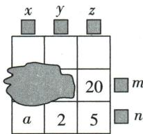
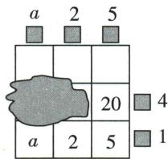
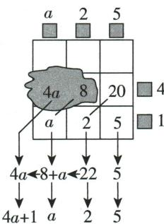

> [!success]- 必刷题
>
> > [!success] **【答案】** D
>
> > [!note]- **【解析】**
> > 设这个三位数与这个两位数分别为 $100x + 10y + z$ 和 $10m + n(x, y, z, m, n$ 均为小于 10 的正整数), 如图(1), 则由题意得 $mz = 20, nz = 5, ny = 2$ , $nx = a$ , 所以 $\frac{mz}{nz} = 4$ , 则 $m = 4n$ , 所以当 $n = 2, y = 1$ 时, $z = 2.5$ , 不是正整数, 不符合题意, 故舍去;
> >
> > 当 n=1, y=2 时, m=4, z=5, x=a, 如图(2)所示.
> >
> > 
> >
> >   
> > 图(1)  
> > 图(2)
> >
> > A 选项, “20” 左边的数是 $2 \times 4 = 8$ , 故本选项不符合题意; B 选项, “20” 右边的“☐”表示 4, 故本选项不符合题意; 根据题意可得, 表格中被墨迹覆盖的数据应为 $4a$ , 8, 如图(3).
> >
> >   
> > 图(3)  
> > 所以运算结果可以表示为 $1000(4a+1)+100a+25=$ 4 100a+1 025, 故 D 选项符合题意;
> > 当 a=2 时, 运算结果大于 6000, 故 C 选项不符合题意.
> >
> > 故选 **D**.
