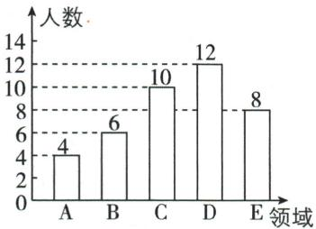

> [!success]- 必刷题
>
> > [!success] **【答案】** ①B, ②D
>
> > [!note]- **【解析】**
> > 【解】(1)由条形统计图可知选择 A 领域的有 4 人, 由扇形统计图可知选择 A 领域的人数占本次调查所抽取的学生人数的 10%, 所以本次调查所抽取的学生人数为 $4 \div 10\% = 40$ , 所以选择 D 领域的有 40-4-6-10-8 = 12 (人), 补全条形统计图如图所示.
> >
> > 
> >
> > (2) $\frac{8}{40}\times360^{\circ}=72^{\circ}$ ，故扇形统计图中“E”对应扇形的圆心角的度数为 $72^{\circ}$ .
> >
> > (3)选择聆听 B 领域报告的有 $\frac{6}{40} \times 600 = 90$ (人), 选择聆听 D 领域报告的有 $\frac{12}{40} \times 600 = 180$ (人).
> >
> > (4)由(3)知选择聆听 B 领域报告的有 90 人, 可在 2 号多功能厅, 选择聆听 D 领域报告的有 180 人, 可在 1 号多功能厅. 故答案为①B, ②D.
> >
> > ## 综合与实践
