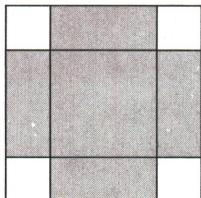
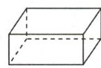

## 全章综合训练 刷中考

是个新“烤”鸭

电子错题本鸭

## 考点 1 数据的收集与整理

![[初中/课堂同步/教辅/必刷题/2026版《初中必刷题》数学 BS  7上/06_第六章_数据的收集与整理/全章综合训练/questions/Q00098612.md]]
![[初中/课堂同步/教辅/必刷题/2026版《初中必刷题》数学 BS  7上/06_第六章_数据的收集与整理/全章综合训练/questions/Q00098613.md]]
## 考点 2 数据的表示

![[初中/课堂同步/教辅/必刷题/2026版《初中必刷题》数学 BS  7上/06_第六章_数据的收集与整理/全章综合训练/questions/Q00098614.md]]
## 建议用时 20 分钟 答案 D62

![[初中/课堂同步/教辅/必刷题/2026版《初中必刷题》数学 BS  7上/06_第六章_数据的收集与整理/全章综合训练/questions/Q00098615.md]]
![[初中/课堂同步/教辅/必刷题/2026版《初中必刷题》数学 BS  7上/06_第六章_数据的收集与整理/全章综合训练/questions/Q00098616.md]]
## 一、选择题(本大题共5小题,每小题8分,共40分)

为了了解某市 50 000 名学生参加初中毕业考试数学成绩情况,从中抽取了 2 000 名考生的数学成绩进行统计分析,在这次调查中,下列说法:①这 50 000 名学生参加初中毕业考试数学成绩的全体是总体;②每个考生是个体;③2 000 名考生是总体的一个样本;④样本容量是 2 000. 正确的是 ( )
A. ①②③ B. ①②
C. ②③ D. ①④

![[初中/课堂同步/教辅/必刷题/2026版《初中必刷题》数学 BS  7上/06_第六章_数据的收集与整理/全章综合训练/questions/Q00098617.md]]
![[初中/课堂同步/教辅/必刷题/2026版《初中必刷题》数学 BS  7上/06_第六章_数据的收集与整理/全章综合训练/questions/Q00098618.md]]
![[初中/课堂同步/教辅/必刷题/2026版《初中必刷题》数学 BS  7上/06_第六章_数据的收集与整理/全章综合训练/questions/Q00098619.md]]
![[初中/课堂同步/教辅/必刷题/2026版《初中必刷题》数学 BS  7上/06_第六章_数据的收集与整理/全章综合训练/questions/Q00098620.md]]
## 二、填空题(本大题共2小题,每小题10分,共20分)

![[初中/课堂同步/教辅/必刷题/2026版《初中必刷题》数学 BS  7上/06_第六章_数据的收集与整理/全章综合训练/questions/Q00098621.md]]
![[初中/课堂同步/教辅/必刷题/2026版《初中必刷题》数学 BS  7上/06_第六章_数据的收集与整理/全章综合训练/questions/Q00098622.md]]
## 三、解答题(共40分)

![[初中/课堂同步/教辅/必刷题/2026版《初中必刷题》数学 BS  7上/06_第六章_数据的收集与整理/全章综合训练/questions/Q00098623.md]]
![[初中/课堂同步/教辅/必刷题/2026版《初中必刷题》数学 BS  7上/06_第六章_数据的收集与整理/全章综合训练/questions/Q00098624.md]]
## 实践

[2024 山西吕梁期末, 中]在数学活动课上, 老师让同学们制作了一些边长为 20 cm 的正方形纸片, 并要求各个小组利用这些纸片研究数学问题.

【设计方案】(1)勤勉小组提出:将如图(1)所示的纸片的四个角各剪去一个边长为x cm的正方形,得到图(1)中的阴影部分,请计算阴影部分的面积S(用含x的式子表示),并求出当x=3时,阴影部分的面积.

(2) 创新小组将图(1)中的阴影部分折成一个无盖的长方体盒子, 如图(2), 设长方体的容积为 $V \, cm^{3}$ , 若用含有 x 的代数式表示 V, 则 V= \_\_\_\_.

【实施方案】根据(2)中结果,填写下表:

<table><tr><td>x(cm)</td><td>1</td><td>2</td><td>3</td><td>4</td><td>5</td><td>6</td><td>7</td></tr><tr><td>V(cm3)</td><td>324</td><td>512</td><td></td><td></td><td>500</td><td>384</td><td>252</td></tr></table>

(3)先补全表格,再观察表格中容积 V 的值是否随 x 值的增大而增大? 此时当 x 取什么整数值时,容积 V 的值最大?

【评估反思】课后小英同学继续对这个问题作了以下探究：

当 x=3.2 时, V=591.872; 当 x=3.3 时, V=592.548;

当 $x = 3.4$ 时， $V = 592.416$ ；当 $x = 3.5$ 时， $V = 591.5$ .

小英同学发现使 V 最大的 x 的取值一定介于 3.3 和 3.4 之间, 估计 x 的取值还能更精确些, 小英再计算 $x = 3.33, 3.333, 3.3333 \cdots$ 时, 发现 V 的值还在逐渐增大.

(4) 现请你也观察数据变化, 能否推测 x 可以取到哪一个定值, 容积 V 的值最大? 最大值是多少? (直接写出结论)

  
图(1)

图(2)  
  
一日不书百事荒芜

考向解读 教育部发布的《关于加强初中学业水平考试命题工作的意见》中指出:试题命制既要注重考查基础知识、基本技能,还要注重考查思维过程、创新意识和分析问题、解决问题的能力.结合不同学科特点,合理设置试题结构,减少机械记忆试题和客观性试题比例,提高探究性、开放性、综合性试题比例,积极探索跨学科命题.结合《义务教育数学课程标准(2022年版)》新变化,通过分析全国百余套中考试题,发现以传统文化为背景的试题,以及探究性、开放性、综合性、跨学科试题比例在中考试题中出现得越来越频繁,故精选部分试题,让学生感受考向变化.

## - 新考向 1 传统文化 •
