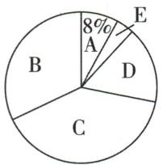
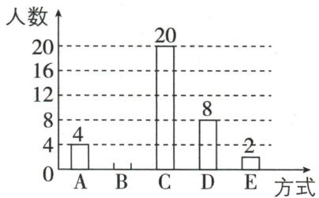

## 关注人口老龄化

[2024 山西晋中质检, 中]近年来, 人口老龄化现象日益严峻, 引起全社会的广泛关注. 某校为引导学生关注社会生活, 关爱老年人, 就当地老年人生活状况展开调查研究.

【收集数据,描述数据】学校对当地某社区部分老年人的生活状况之处理生病问题的方式进行了调查,经过对问卷的整理,得到结果并形成如下调查报告:

<table><tr><td>课题主题</td><td>当地老年人生活状况调查——处理生病问题的方式</td></tr><tr><td>活动目标</td><td>关注社会生活,关爱老年人,增强社会责任意识和关爱他人的意识,促进全面发展</td></tr><tr><td>调查方式</td><td>抽样调查</td></tr><tr><td rowspan="2">数据的收集、整理与描述</td><td>处理生病问题的方式的调查问卷您好!这是一份关于处理生病问题的方式的调查问卷,请选择一项您最常使用的方式,在其后的括号内打“√”,非常感谢您的配合!A.子女陪同去医院就诊( );B.独自去医院就诊( );C.自己在家里服用备用药( );D.请人帮忙购药( );E.雇佣他人陪同去医院就诊( )</td></tr><tr><td>所有问卷全部收回,并将调查结果绘制成如下两幅不完整的统计图:</td></tr><tr><td>调查结论</td><td>......</td></tr></table>

【评估反思】(1)在扇形统计图中,“D”所占的百分比为\_\_\_\_,“C”所在扇形的圆心角度数为\_\_\_\_度,请补全条形统计图.

(2)根据调查结果,估计该社区500名老年人中感觉身体不适时,选择独自去医院就诊的人数.

(3)请你结合上述调查报告写出两条通过分析获取的信息.

## 实践

[2024 山西吕梁期末, 中]在数学活动课上, 老师让同学们制作了一些边长为 20 cm 的正方形纸片, 并要求各个小组利用这些纸片研究数学问题.

【设计方案】(1)勤勉小组提出:将如图(1)所示的纸片的四个角各剪去一个边长为x cm的正方形,得到图(1)中的阴影部分,请计算阴影部分的面积S(用含x的式子表示),并求出当x=3时,阴影部分的面积.
