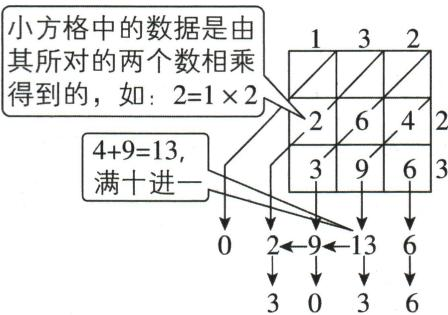
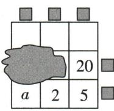

<!-- question-source:start -->
4[2024 河北中考]“铺地锦”是我国古代一种乘法运算方法,可将多位数乘法运算转化为一位数乘法和简单的加法运算. 淇淇受其启发,设计了如图(1)所示的“表格算法”,图(1)表示

建议用时 35 分钟 答案 D63

132×23,运算结果为3036.图(2)表示一个三位数与一个两位数相乘,表格中部分数据被墨迹覆盖,根据图(2)中现有数据进行推断,正确的是()

图(1)
图(2)
A. “20”左边的数是16
B. “20”右边的“□”表示5
C. 运算结果小于6000
D. 运算结果可以表示为 $4100a + 1025$
<!-- question-source:end -->

![[Q00102757A1]]
