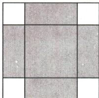
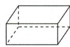
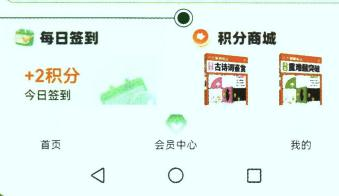
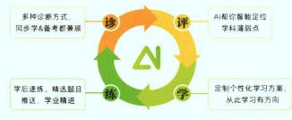
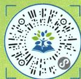

## 制作一个尽可能大的无盖长方体形收纳盒

(2) 创新小组将图(1)中的阴影部分折成一个无盖的长方体盒子, 如图(2), 设长方体的容积为 $V \, cm^{3}$ , 若用含有 x 的代数式表示 V, 则 V= \_\_\_\_.

【实施方案】根据(2)中结果,填写下表:

<table><tr><td>x(cm)</td><td>1</td><td>2</td><td>3</td><td>4</td><td>5</td><td>6</td><td>7</td></tr><tr><td>V(cm3)</td><td>324</td><td>512</td><td></td><td></td><td>500</td><td>384</td><td>252</td></tr></table>

(3)先补全表格,再观察表格中容积 V 的值是否随 x 值的增大而增大? 此时当 x 取什么整数值时,容积 V 的值最大?

【评估反思】课后小英同学继续对这个问题作了以下探究：

当 x=3.2 时, V=591.872; 当 x=3.3 时, V=592.548;

当 $x = 3.4$ 时， $V = 592.416$ ；当 $x = 3.5$ 时， $V = 591.5$ .

小英同学发现使 V 最大的 x 的取值一定介于 3.3 和 3.4 之间, 估计 x 的取值还能更精确些, 小英再计算 $x = 3.33, 3.333, 3.3333 \cdots$ 时, 发现 V 的值还在逐渐增大.

(4) 现请你也观察数据变化, 能否推测 x 可以取到哪一个定值, 容积 V 的值最大? 最大值是多少? (直接写出结论)

图(1)

图(2)

一日不书百事荒芜

考向解读 教育部发布的《关于加强初中学业水平考试命题工作的意见》中指出:试题命制既要注重考查基础知识、基本技能,还要注重考查思维过程、创新意识和分析问题、解决问题的能力.结合不同学科特点,合理设置试题结构,减少机械记忆试题和客观性试题比例,提高探究性、开放性、综合性试题比例,积极探索跨学科命题.结合《义务教育数学课程标准(2022年版)》新变化,通过分析全国百余套中考试题,发现以传统文化为背景的试题,以及探究性、开放性、综合性、跨学科试题比例在中考试题中出现得越来越频繁,故精选部分试题,让学生感受考向变化.

## - 新考向 1 传统文化 •

![[初中/课堂同步/教辅/必刷题/2026版《初中必刷题》数学 BS  7上/06_第六章_数据的收集与整理/制作一个尽可能大的无盖长方体形收纳盒/questions/Q00103248.md]]
![[初中/课堂同步/教辅/必刷题/2026版《初中必刷题》数学 BS  7上/06_第六章_数据的收集与整理/制作一个尽可能大的无盖长方体形收纳盒/questions/Q00102755.md]]
![[初中/课堂同步/教辅/必刷题/2026版《初中必刷题》数学 BS  7上/06_第六章_数据的收集与整理/制作一个尽可能大的无盖长方体形收纳盒/questions/Q00102756.md]]
![[初中/课堂同步/教辅/必刷题/2026版《初中必刷题》数学 BS  7上/06_第六章_数据的收集与整理/制作一个尽可能大的无盖长方体形收纳盒/questions/Q00102757.md]]
![[初中/课堂同步/教辅/必刷题/2026版《初中必刷题》数学 BS  7上/06_第六章_数据的收集与整理/制作一个尽可能大的无盖长方体形收纳盒/questions/Q00102758.md]]

## - 新考向 2 跨学科综合 •

![[初中/课堂同步/教辅/必刷题/2026版《初中必刷题》数学 BS  7上/06_第六章_数据的收集与整理/制作一个尽可能大的无盖长方体形收纳盒/questions/Q00102759.md]]
![[初中/课堂同步/教辅/必刷题/2026版《初中必刷题》数学 BS  7上/06_第六章_数据的收集与整理/制作一个尽可能大的无盖长方体形收纳盒/questions/Q00102760.md]]
![[初中/课堂同步/教辅/必刷题/2026版《初中必刷题》数学 BS  7上/06_第六章_数据的收集与整理/制作一个尽可能大的无盖长方体形收纳盒/questions/Q00102761.md]]

## - 新考向 3 开放性试题 -

![[初中/课堂同步/教辅/必刷题/2026版《初中必刷题》数学 BS  7上/06_第六章_数据的收集与整理/制作一个尽可能大的无盖长方体形收纳盒/questions/Q00102762.md]]
![[初中/课堂同步/教辅/必刷题/2026版《初中必刷题》数学 BS  7上/06_第六章_数据的收集与整理/制作一个尽可能大的无盖长方体形收纳盒/questions/Q00102763.md]]
![[初中/课堂同步/教辅/必刷题/2026版《初中必刷题》数学 BS  7上/06_第六章_数据的收集与整理/制作一个尽可能大的无盖长方体形收纳盒/questions/Q00102764.md]]
![[初中/课堂同步/教辅/必刷题/2026版《初中必刷题》数学 BS  7上/06_第六章_数据的收集与整理/制作一个尽可能大的无盖长方体形收纳盒/questions/Q00102765.md]]

## - 新考向 4 22 版课标新增知识点

## 代数推理

![[初中/课堂同步/教辅/必刷题/2026版《初中必刷题》数学 BS  7上/06_第六章_数据的收集与整理/制作一个尽可能大的无盖长方体形收纳盒/questions/Q00102766.md]]

# “理想树图书”专属【会员&增值】服务平台

小程序

微信扫图书背面二维码注册会员

会员中心

当前等级V1理想树V1

会员领券

周六抽奖

错题打印

图书兑换动书600+本动态教辅书同步更新

学法全学科知识总结与学法提炼

理想
头条
活动公告 你的笔记值得炫耀！
英语 【VOA慢速】具有敏锐洞察力的“鹰眼”

图书增值
全套资源，一键畅享

错题本边学边攒错题本

AI改作文AI智能批改，专业写作帮手

诊评学练，一步到位，智能伴学，学业精进

## 青藤计划 {以书载梦，以行践责——青藤计划公益项目}

理想树联合中国光华科技基金会共建公益助学行动，设立100万专项基金。每一笔善款都经由国家级4A基金会专业运作，让善意在阳光下开枝散叶。

若您身边有亟需帮助的学子，请以学校为单位与我们联系，我们与您携手并肩，为每一个理想全力以赴。

邮箱地址：67book@lxzwedu.com
联系电话：400-688-9167

## 作文大赛 {真题作文爆改行动全网捞显眼包！}

扫码解锁更多攻略

真题作文太难了？不存在的！

2025年6月7日—8月10日
持续收集新中考真题作文，投稿即有机会解锁SSR级奖励！

刷题小手 点点关注

@理想树初中

[媒体号]

@众望教育集团

活动专区

句有引力 {笔尖星光，页脚绽放
——理想树页脚语征集}

把你的感悟写成便签，塞进理想树书页的缝隙

某年某月，当陌生人的指尖翻到这里——你的句子，会轻轻叩响一颗共鸣的心

优质稿件可获得精美礼品
每月7日前在理想树初中公众号公布

活动时间
即日起—2025年12月31日

▶ 扫码即可投稿参与活动

@理想树图书官方号

@理想树图书官方

小红书

@理想树必刷题 试题网
www.stzy.com

众望教育官网
www.lxzwedu.com

# 我害怕你

小考、中考，期中考、期末考，单元考、月考，你从各种考试中走来。

选择题、填空题、解答题；
作用力的问题、赛跑的问题、溶液的问题；
你认不认得这个字，你会写吗；
他活了多少岁，他做了几件好事、几件坏事；
函数、三角形还有一个圆，达·芬奇画画都在用的那些原理；

run还是running，加to还是for；

Oh，你天天都在刷。

我害怕你，刷题的人。
一道题，一打眼你就知道考的是哪个知识点；
一看选项，你就知道错在哪里，
你就知道那是个陷阱。
你看透了出题人，
他们的那些挖空心思、绞尽脑汁，
在你面前都是一些无法遁形的小小伎俩。
拿起试卷，你嘴角上扬，
你可知道，那是只属于赢家的笑。

我害怕你，刷题的人。
你用自己活生生地界定了学神与学霸灵魂上的差别：学霸题海里游出一身肌肉，学神题海里踏出一条大道。

你明白刷题的意义，

你知道刷题的好与坏。

你懂得分类，

你有自己的一套策略。

我害怕你，刷题的人。
人世间的种种，
甚至是生活的种种逻辑，
逃不出刷题的范围。
你去琢磨，你去钻研，
你用刷题的逻辑解决生活中遇到的问题，
你发现毫不违和，通行天下。

每天，你来到教室，
坐下来，拉开架势，
打开那本仿佛可以轻松拿下的教科书，
似乎要虽千万人吾往矣。

你明白，
你明白这是一条不得不走的路。
你明白有些东西考过即扔，
希望老死不相往来。
你明白，你都明白。

而你不言不语，不怒不哀，不逃不躲，
你打下整个世界，
天朗气清，惠风和畅。
