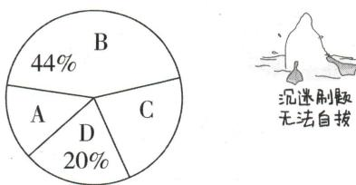

<!-- question-source:start -->
2[2025 新疆乌鲁木齐期末, 中] 优秀的中华民族有很多传统习俗, 其中端午节吃粽子就是一种. 某食品厂为了了解市民对去年销售较好的 A、B、C、D 四种粽子的喜爱情况, 在端午节前通过发放粽子对某小区居民进行抽样调查 (每人只选一种粽子), 其中 A 种粽子发放了 70 个, B 种粽子发放了 220 个, 根据如下不完整扇形统计图, 可知 C 种粽子所在扇形的圆心角的度数是 \_\_\_\_.

<!-- question-source:end -->
