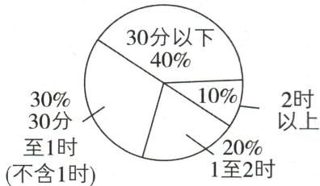

<!-- question-source:start -->
3[2025 福建泉州期末]某校开展“阅读助成长，课程蕴书香”活动,对全校学生每天的课外阅读时间进行了普查,根据收集的相关数据绘制成如图所示的扇形统计图.下列说法错误的是（）

A. 每天阅读不足 30 分的学生人数最多  
B. 每天阅读 30 分及以上的学生人数超过 $50\%$ C. 每天阅读 1 时及以上的学生人数占 $20\%$ D. 每天阅读 30 分至 2 时的学生人数占 $50\%$
<!-- question-source:end -->
