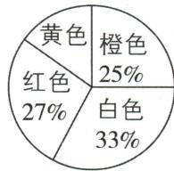

<!-- question-source:start -->
5[2024 四川成都调研]某马拉松活动组委会计划制作橙色、黄色、白色、红色四种颜色的运动衫发给参与者,为此调查了

部分参与者对运动衫颜色的选择,根据得到的调查数据,绘制成如图所示的扇形统计图.若本次活动共有40 000名参与者,则估计其中选择黄色运动衫的参与者有\_\_\_\_名.
<!-- question-source:end -->
