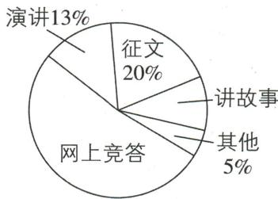

<!-- question-source:start -->
6 某中学为了解学生最喜爱的活动形式,以“我最喜爱的一种读书活动”为主题,进行随机抽样调查,收集数据整理后,绘制出如下两幅不完整的统计图表,请根据图中提供的信息,解答下面的问题:

最喜爱的一种读书活动统计表

<table><tr><td>活动形式</td><td>征文</td><td>讲故事</td><td>演讲</td><td>网上竞答</td><td>其他</td></tr><tr><td>人数</td><td>60</td><td>30</td><td>39</td><td>a</td><td>b</td></tr></table>

(1)在这次抽样调查中,一共调查了\_\_\_\_名学生,a=\_\_\_\_.

(2)扇形统计图中“讲故事”部分的圆心角是多少度？
最喜爱的一种读书活动扇形统计图

<!-- source-part:3 pages:101-113 -->
<!-- question-source:end -->
