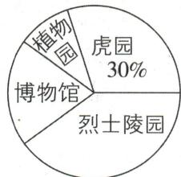
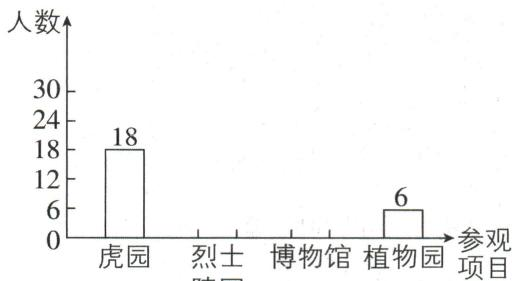

<!-- question-source:start -->
4[难]某校在一次社会实践活动中,组织学生参观了虎园、烈士陵园、博物馆和植物园,为了解本次社会实践活动的效果,学校随机抽取了部分学生,对“最喜欢的景点”进行了问卷调查,并根据统计结果绘制了如下不完整的统计图.其中最喜欢烈士陵园的学生人数与最喜欢博物馆的学生人数之比为2:1,请结合统计图解答下列问题:

(1)本次活动抽查了\_\_\_\_名学生；

(2)请补全条形统计图；

(3)在扇形统计图中,最喜欢植物园的学生人数所对应扇形的圆心角是\_\_\_\_度;

(4)该校此次参加社会实践活动的学生有720人,请估计最喜欢烈士陵园的人数.

最喜欢的景点的学生人数的扇形统计图

最喜欢的景点的学生人数的条形统计图

  
陵园
<!-- question-source:end -->
