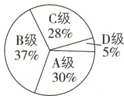
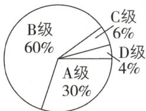

<!-- question-source:start -->
1[2025 河南周口质检, 中]某公司生产的一种产品按照质量由高到低分为 A、B、C、D 四级, 为了增加产量、提高质量, 该公司改进了一次生产工艺, 使得生产总量增加了一倍. 为了解新生产工艺的效果, 对改进生产工艺前、后的四级产品的占比情况进行了统计, 绘制了如下扇形统计图:

改进生产工艺前

改进生产工艺后

根据以上信息,下列推断合理的是 ( )
A. 改进生产工艺后, A 级产品的生产量没有变化
B. 改进生产工艺后, B 级产品的生产量增加了不到一倍
C. 改进生产工艺后, C 级产品的生产量减少
D. 改进生产工艺后, D 级产品的生产量减少
<!-- question-source:end -->

![[Q00103213A1]]
