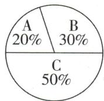
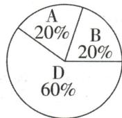

<!-- question-source:start -->
3[中]如图是小垣同学某两天进行四个体育项目(A、B、C、D)锻炼的时间统计图,第一天锻炼了1时,第二天锻炼了40分.根据统计图,小垣这两天体育锻炼时间最长的项目是\_\_\_\_.
(填“A”“B”“C”或“D”)

第一天

第二天
<!-- question-source:end -->

![[Q00103215A1]]
