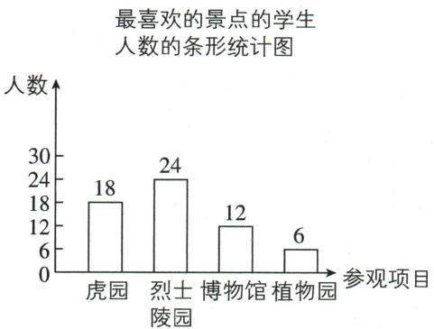

> [!success]- 必刷题
>
> > [!success] **【答案】** 36
>
> > [!note]- **【解析】**
> > (1) 60
> >
> > 【解】(2)设最喜欢博物馆的学生人数为 x，则最喜欢烈士陵园的学生人数为 $2x. x + 2x = 60 - 18 - 6$ ，解得 x = 12。即最喜欢博物馆的学生人数为 12，最喜欢烈士陵园的学生人数为 24。补全条形统计图如下：
> >
> > 
> >
> > (3)在扇形统计图中,最喜欢植物园的学生人数所对应扇形的圆心角是 $360^{\circ}\times\frac{6}{60}=36^{\circ}$ ,故答案为36.
> >
> > 归纳总结
> > 条形统计图能很清楚地看出数量的多少；折线统计图能反映数量的增减变化情况；扇形统计图能反映部分与整体的关系。由此根据具体情况选择即可。
> >
> > (4) 最喜欢烈士陵园的人数约为 $720 \times \frac{24}{60} = 288$ .
